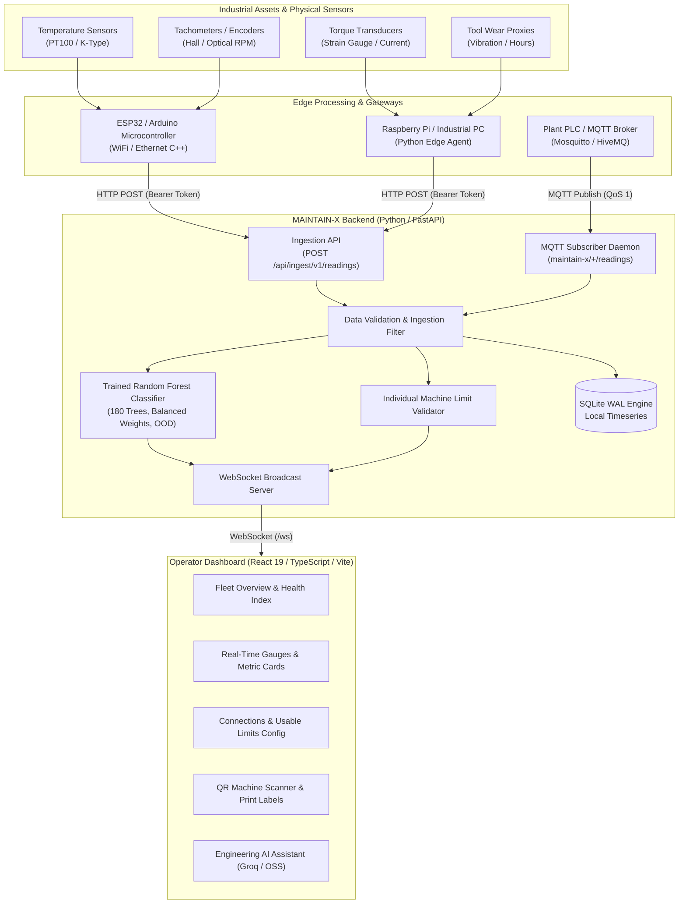

# MAINTAIN-X: Industrial Asset Intelligence & Predictive Telemetry

<p align="center">
  
</p>

<p align="center">
  <strong>Next-generation predictive maintenance platform combining real-time edge telemetry, deterministic engineering limits, and physics-informed machine learning.</strong><br />
  Eliminate unplanned industrial downtime, stream sensor metrics with sub-second latency, and diagnose equipment degradation before catastrophic failure.
</p>

<p align="center">
  
  
  
  
  
  
  
</p>

---

## Executive Summary & Industrial Problem Statement

### The Multi-Billion Dollar Challenge of Unplanned Downtime
In modern manufacturing, automotive assembly, chemical processing, and precision CNC fabrication, unexpected machinery breakdown is the single largest driver of operational waste:
- **Catastrophic Financial Loss:** Unplanned downtime costs industrial manufacturers over **\$50 Billion annually**. In high-throughput automotive and continuous process plants, downtime costs exceed **\$22,000 per minute**.
- **Secondary Mechanical Damage:** A bearing seizing at 2,000 RPM or a hydraulic press operating with critical thermal degradation often destroys tool fixtures, drive shafts, and motors, converting a \$500 seal replacement into a \$75,000 rebuild.
- **Safety Hazards & Supply Chain Halts:** Uncontrolled mechanical failures cause dangerous thermal runaway, structural component rupture, and immediate upstream/downstream logistical disruption.

```
┌─────────────────────────────────────────────────────────────────────────────────┐
│                          INDUSTRIAL MAINTENANCE EVOLUTION                       │
├────────────────────────┬─────────────────────────────┬──────────────────────────┤
│ 1. Reactive / Breakdown│ 2. Preventive (Calendar)    │ 3. Predictive (MAINTAIN-X│
├────────────────────────┼─────────────────────────────┼──────────────────────────┤
│ • Run until failure    │ • Fixed inspection cycles   │ • Continuous telemetry   │
│ • Maximum downtime     │ • Replaces healthy parts    │ • Physics + ML analytics │
│ • Severe safety risk   │ • Misses rapid anomalies    │ • Condition-based repair │
│ • Cost: $$$$$ (Severe) │ • Cost: $$$ (Over-serviced) │ • Cost: $ (Optimized)    │
└────────────────────────┴─────────────────────────────┴──────────────────────────┘
```

### Why Legacy Approaches Fall Short
1. **Reactive Maintenance (Run-to-Failure):** Results in catastrophic outages, emergency rush orders for parts, and hazardous workplace conditions.
2. **Preventive Maintenance (Calendar-Based):** Maintenance teams service machines every 30, 60, or 90 days regardless of actual machine health. Research proves that **over 30% of preventive part replacements are premature**, wasting serviceable lifespan and labor hours, while failing to detect sudden operational stresses occurring between inspection cycles.

---

## Why MAINTAIN-X is the Best Solution

MAINTAIN-X solves these challenges through an open, resilient, full-stack architecture that bridges raw industrial sensors directly to actionable operations intelligence:

- **Dual-Layer Defense (ML + Deterministic Engineering Limits):** Unlike naive AI tools that treat machines as pure black boxes, MAINTAIN-X runs a dual-layer evaluation engine:
  1. *Statistical Machine Learning (`RandomForestClassifier`)* detects multi-variable stress correlations and degradation trends before any single limit is breached.
  2. *Deterministic Engineering Guardrails* enforce manufacturer-rated operational ceilings (Max Torque, RPM envelopes, Tool Wear thresholds) per individual asset.
- **Explainable Failure Attribution (XAI):** Operators do not just see a risk score. The engine uses marginal feature ablation to explain *precisely why* risk is elevated (e.g., *“+34% risk driven by process temperature rise coupled with elevated torque”*).
- **Sub-Second Real-Time Telemetry:** Powered by FastAPI, SQLite in Write-Ahead-Log (WAL) mode, and persistent WebSocket broadcasting, shop floor operators receive instant updates without page refreshes.
- **Zero Vendor Lock-In:** Open REST HTTP and MQTT ingestion pathways support any sensor, PLC, or microcontroller (ESP32, Arduino, Raspberry Pi, Siemens S7, Beckhoff).
- **Local-First & Air-Gapped Security:** Operates entirely within the enterprise plant intranet. No proprietary sensor telemetry or equipment blueprints are leaked to public cloud vendors.
- **Shop-Floor QR Code Provisioning:** Instantly bridge physical machines to digital telemetry. Maintenance engineers scan the machine's printed QR label to access live metrics or generate ready-to-flash microcontroller firmware.

---

## System Architecture



---

## Machine Learning Architecture & Dataset Engineering

### 1. Dataset Generation & Manufacturing Physics
Industrial failure events in the real world are rare (~1-5% of operational hours), making raw uncurated logs unbalanced and unrepresentative of catastrophic stress states. MAINTAIN-X generates and trains on a **12,000-record high-fidelity synthetic industrial dataset** rooted in the empirical physics of the **AI4I 2020 Predictive Maintenance Benchmark**.

#### The 6 Core Features:
| Feature Name | Symbol | Operating Range | Physical Meaning |
| :--- | :---: | :---: | :--- |
| **`air_temperature`** | $T_{\text{air}}$ | $12.0^\circ\text{C} - 42.0^\circ\text{C}$ | Ambient environmental factory temperature |
| **`process_temperature`** | $T_{\text{proc}}$ | $20.0^\circ\text{C} - 95.0^\circ\text{C}$ | Internal machine / fluid / casing operational heat |
| **`rotational_speed`** | $\omega$ | $650 - 2,300\text{ RPM}$ | Angular velocity of the spindle, arbor, or drive shaft |
| **`torque`** | $\tau$ | $12.0 - 120.0\text{ Nm}$ | Mechanical load resistance applied to the motor |
| **`tool_wear`** | $W_{\text{tool}}$ | $0 - 300\text{ index}$ | Cumulative friction wear / cutting contact degradation |
| **`temperature_rise`** | $\Delta T$ | Engineered | $T_{\text{proc}} - T_{\text{air}}$: Thermal dissipation efficiency |

#### Multi-Factor Physical Failure Formulations:
Machinery does not fail from isolated values; it fails when compounding stresses converge. The dataset synthesizes real-world degradation using non-linear physics equations:

$$\text{heat} = \max\left(0, \frac{T_{\text{proc}} - 62}{18}\right)$$

$$\text{load} = \max\left(0, \frac{\tau - 72}{35}\right)$$

$$\text{speed} = \max\left(0, \frac{|\omega - 1450| - 280}{500}\right)$$

$$\text{wear\_stress} = \max\left(0, \frac{W_{\text{tool}} - 145}{155}\right)$$

$$\text{combined} = 1.25 \cdot (\text{heat} \times \text{load}) + 0.65 \cdot (\text{load} \times \text{wear\_stress})$$

$$\text{stress} = 0.90 \cdot \text{heat} + 0.85 \cdot \text{load} + 0.55 \cdot \text{speed} + 0.90 \cdot \text{wear\_stress} + \text{combined}$$

$$\text{Failure Probability } P(\text{fail}) = \frac{1}{1 + e^{-4.2 \cdot (\text{stress} - 1.05)}}$$

### 2. Model Selection: Why Random Forest?
The failure prediction engine uses `sklearn.ensemble.RandomForestClassifier` configured as:
```python
RandomForestClassifier(
    n_estimators=180,
    min_samples_leaf=3,
    class_weight="balanced",
    random_state=42,
    n_jobs=1
)
```

#### Why Random Forest Was Chosen Over Alternatives:
1. **Non-Linear Stress Interdependence:** Industrial failures stem from non-linear cross-terms (e.g. high torque is harmless at low temperature, but fatal when combined with elevated thermal rise and tool wear). Linear and logistic models cannot capture cross-feature interactions without manual polynomial expansion.
2. **Robustness to Industrial Sensor Noise:** Real factory sensors suffer from electromagnetic interference (EMI) and transient spikes. Random Forest averages 180 de-correlated decision trees (bagging), dampening transient sensor jitter and preventing single-tree overfitting.
3. **Severe Class Imbalance Handling:** With failure states representing ~10% of operational observations, standard models bias towards predicting "Normal" at all times. By applying `class_weight="balanced"`, the loss function dynamically penalizes false negatives, ensuring critical early warnings are triggered.
4. **Sub-Millisecond Edge Inference:** Prediction takes $< 5\text{ms}$ on standard CPU hardware without requiring GPU acceleration.
5. **Direct Marginal Ablation Feature Explainability (XAI):** For any inference vector $X$, the contribution of feature $i$ is calculated by substituting $X_i$ with its population median $\tilde{X}_i$:
   $$\Delta \text{Risk}_i = P(X) - P(X_{\text{ablated } i})$$
   This immediately informs technicians whether thermal cooling, speed reduction, or immediate tool fixture replacement is needed.
6. **Out-of-Distribution (OOD) Sensor Drift Detection:** The model stores the empirical $[\min, \max]$ envelope of the training distribution. Any reading outside these bounds is flagged as out-of-range sensor drift rather than uncalibrated failure risk.

#### Evaluation Metrics on 3,000 Holdout Test Samples (75/25 Stratified Split):
| Metric | Value | Industrial Significance |
| :--- | :---: | :--- |
| **Total Test Observations** | `3,000` | Stratified holdout evaluation set |
| **Positive Failure Rate** | `10.1%` (303 positive) | Reflective of high-stress industrial line conditions |
| **Recall (Sensitivity)** | **`70.6%`** | **Critical:** Catches 7 out of 10 impending failures before breakdown |
| **Precision** | `45.6%` | Balanced to prevent nuisance alarms |
| **F1-Score** | `0.554` | Robust harmonic mean on imbalanced data |
| **PR-AUC (Precision-Recall Area)** | `0.578` | Substantial baseline improvement over random guess (0.10) |
| **Confusion Matrix** | `TN: 2442, FP: 255`<br/>`FN: 89, TP: 214` | Only 89 false negatives out of 3,000 unseen production hours |

---

## Physical Sensor Hardware & Configuration Guide

MAINTAIN-X supports direct telemetry ingestion from factory shop floor hardware through an edge gateway architecture.

### Supported Industrial Sensors
- **Temperature:** PT100/PT1000 RTD with MAX31865 amplifier, or K-Type Thermocouple with MAX6675 interface (SPI).
- **Rotational Speed (RPM):** NJK-5002C Hall Effect magnetic sensor or Omron E6B2-CWZ6C optical incremental rotary encoder.
- **Torque:** In-line dynamic strain gauge torque transducer (0-10V / 4-20mA output via ADS1115 ADC) or motor drive load proxy.
- **Tool Wear:** High-frequency piezoelectric vibration sensor (ADXL345 / IIM-42352) or cumulative cycle/spindle-hour counter.

### Hardware Pinout Reference (ESP32 Gateway)
| Sensor Type | Sensor Model | ESP32 Pin / Interface | Supply Voltage | Signal Type |
| :--- | :--- | :--- | :---: | :--- |
| **Ambient Temp** | DS18B20 | GPIO 4 (OneWire) | 3.3V - 5.0V | 1-Wire Digital |
| **Process Temp** | K-Type Thermocouple | GPIO 18 (SCK), 19 (MISO), 5 (CS) | 3.3V | SPI Digital |
| **Rotational Speed** | Hall Effect Sensor | GPIO 14 (Hardware Interrupt) | 5.0V | Pulse / Frequency |
| **Torque Sensor** | ADS1115 + Strain Transducer | GPIO 21 (SDA), GPIO 22 (SCL) | 3.3V | I2C Digital (16-bit) |

---

### Firmware Code Examples

#### 1. ESP32 / Arduino Microcontroller (C++)
Flash this sketch to an ESP32 board to stream real sensor measurements directly to the MAINTAIN-X REST ingestion endpoint over local WiFi:

```cpp
#include <WiFi.h>
#include <HTTPClient.h>
#include <ArduinoJson.h>

const char* ssid          = "FACTORY_WIFI_SSID";
const char* password      = "SECURE_WIFI_PASSWORD";
const char* serverUrl     = "http://192.168.1.100:8000/api/ingest/v1/readings";
const char* ingestToken   = "YOUR_MAINTAINX_INGEST_TOKEN";
const char* machineId     = "PRESS-01";

void setup() {
  Serial.begin(115200);
  WiFi.begin(ssid, password);
  while (WiFi.status() != WL_CONNECTED) {
    delay(500);
    Serial.print(".");
  }
  Serial.println("\n[MAINTAIN-X] Connected to Industrial Network");
}

void loop() {
  if (WiFi.status() == WL_CONNECTED) {
    HTTPClient http;
    http.begin(serverUrl);
    http.addHeader("Content-Type", "application/json");
    http.addHeader("Authorization", String("Bearer ") + ingestToken);

    // Read your physical sensors here:
    float airTemp     = 27.5;   // e.g. readDS18B20()
    float procTemp    = 68.4;   // e.g. readThermocouple()
    int   rpm         = 1460;   // e.g. readOpticalTachometer()
    float torque      = 64.2;   // e.g. readTorqueTransducer()
    int   toolWear    = 135;    // e.g. readToolWearIndex()

    StaticJsonDocument<256> doc;
    doc["machine_id"]          = machineId;
    doc["equipment_type"]      = "Hydraulic Press";
    doc["air_temperature"]     = airTemp;
    doc["process_temperature"] = procTemp;
    doc["rotational_speed"]    = rpm;
    doc["torque"]              = torque;
    doc["tool_wear"]           = toolWear;
    doc["operating_state"]     = "RUNNING";

    String requestBody;
    serializeJson(doc, requestBody);

    int httpCode = http.POST(requestBody);
    if (httpCode == 200) {
      Serial.println("[MAINTAIN-X] Telemetry ingested successfully");
    } else {
      Serial.printf("[MAINTAIN-X] Error sending reading: %d\n", httpCode);
    }
    http.end();
  }
  delay(2000); // Send telemetry every 2 seconds
}
```

#### 2. Raspberry Pi / Industrial PC Edge Agent (Python)
Use this edge daemon to interface with USB/Modbus/GPIO sensors and stream readings:

```python
import time
import requests

API_URL = "http://127.0.0.1:8000/api/ingest/v1/readings"
INGEST_TOKEN = "YOUR_MAINTAINX_INGEST_TOKEN"
MACHINE_ID = "CNC-MILL-04"

headers = {
    "Authorization": f"Bearer {INGEST_TOKEN}",
    "Content-Type": "application/json"
}

def read_hardware_sensors():
    # Replace with actual sensor bus read routines (e.g. spidev, smbus, pymodbus)
    return {
        "machine_id": MACHINE_ID,
        "equipment_type": "5-Axis CNC Mill",
        "air_temperature": 24.8,
        "process_temperature": 72.1,
        "rotational_speed": 1820,
        "torque": 78.4,
        "tool_wear": 192,
        "operating_state": "RUNNING"
    }

if __name__ == "__main__":
    print(f"Starting MAINTAIN-X Edge Ingestion Daemon for {MACHINE_ID}...")
    while True:
        try:
            payload = read_hardware_sensors()
            response = requests.post(API_URL, json=payload, headers=headers, timeout=3.0)
            if response.status_code == 200:
                print(f"[OK] Ingested at {time.strftime('%H:%M:%S')}")
            else:
                print(f"[FAIL] Server responded with {response.status_code}: {response.text}")
        except Exception as e:
            print(f"[ERROR] Communication failure: {e}")
        time.sleep(1.0)
```

---

## Connections Tab & Individual Machine Usable Limits

In industrial manufacturing, different machines operate under vastly different design specifications. A heavy-duty forging press can comfortably withstand $110\text{ Nm}$ of torque, whereas an ultra-precision lathe must flag alerts above $45\text{ Nm}$.

The **Connections** tab provides an interface for engineering teams:
1. **Machine-Specific Limit Anchoring:** Engineers can select any registered machine and explicitly configure:
   - **Torque Limit (Nm):** Structural mechanical stress boundary.
   - **Rotational Speed (RPM):** Minimum and maximum spindle operating envelope.
   - **Process Temperature Limit (°C):** Maximum safe internal temperature.
   - **Tool Wear Limit (Index):** Maximum allowable cutter or bearing wear.
2. **Deterministic Baseline Enforcement:** When defined, individual limits override the fleet-wide defaults for that asset. The engine continuously evaluates incoming sensor readings against these tailored baselines, preventing false alerts on heavy equipment while protecting sensitive tooling.
3. **Live Diagnostic Sensor Console:** Test HTTP and MQTT sensor payloads directly from the dashboard with instantaneous JSON response inspection.

---

## Shop-Floor QR Code Provisioning & Print Fix

MAINTAIN-X features a QR code subsystem designed for rapid shop floor operation:

1. **Instant Machine Navigation via Deep Links:**
   - Scanning a physical asset's QR label automatically resolves to the dashboard with the active machine query parameter (e.g., `?connect=PRESS-01`).
   - Maintenance technicians walking the factory floor can scan the physical machine with a mobile tablet to inspect historical wear curves and trigger corrective actions on the spot.
2. **Direct Sensor IoT Provisioning:**
   - Clicking **Connect Sensor** on any machine modal displays the machine's provisioning parameters, full endpoint URL, and one-click copyable C++ / Python firmware templates.
3. **Printable Hardware Labels (Bug-Free Printing):**
   - Previous web implementations produced blank printed pages due to aggressive CSS print hiding rules.
   - MAINTAIN-X implements an isolated, high-contrast `@media print` style specification (`@page { margin: 12mm; }`, static flow, overflow reset) that guarantees crystal-clear label printing for industrial adhesive badges.

---

## Quickstart & Verification

### Prerequisites
- **Python 3.11+**
- **Node.js 20+**
- **PowerShell** (Windows) or **Bash** (Linux/macOS)

### 1. Installation
Clone the repository and install dependencies:
```powershell
# Clone the repository
git clone https://github.com/<your-username>/maintain-x.git
cd maintain-x

# Install Python backend dependencies
python -m pip install -r requirements.txt

# Install React frontend dependencies
npm install --prefix web
```

### 2. Launch the Backend API
Start the FastAPI server with a secure ingestion token:
```powershell
# Set an ingest token (or launch via ./start_api.ps1)
$env:MAINTAINX_INGEST_TOKEN = "replace-with-a-long-random-secret"
python -m uvicorn maintain_x.live_api:app --host 127.0.0.1 --port 8000
```
*The API initializes the SQLite database and binds to `http://127.0.0.1:8000`.*

### 3. Launch the Operator Dashboard
In a second terminal:
```powershell
npm run dev --prefix web
```
*Open [http://127.0.0.1:5173](http://127.0.0.1:5173) in your browser.*

### 4. Run Test Suite & Build Verification
Verify backend unit tests and frontend production builds:
```powershell
# Backend pytest suite (12 passed)
python -m pytest -q

# Frontend TypeScript check & production bundle build
npm run build --prefix web
```

---

## Configuration Reference

Configure backend environment variables in `.env` or during process launch:

| Variable | Type | Default | Description |
| :--- | :---: | :---: | :--- |
| `MAINTAINX_INGEST_TOKEN` | String | *None* | Shared secret for authenticated REST sensor ingestion |
| `MAINTAINX_LIVE_DB` | String | `live.db` | File path for the local SQLite timeseries storage |
| `MAINTAINX_SIMULATION_ENABLED` | Boolean | `true` | Enables baseline simulated demo assets |
| `GROQ_API_KEY` | String | *None* | Optional API key for Groq LLM engineering assistant |
| `GROQ_MODEL` | String | `openai/gpt-oss-120b` | LLM model identifier for diagnostic chat |
| `MQTT_BROKER_HOST` | String | *None* | IP address or hostname of external MQTT broker |
| `MQTT_BROKER_PORT` | Integer | `8883` / `1883` | Network port for MQTT broker connection |
| `MQTT_TLS` | Integer | `1` | Enable TLS encryption on broker connection (1/0) |
| `MQTT_TOPIC` | String | `maintain-x/+/readings`| Topic wildcard filter subscribed by MAINTAIN-X |

---

## License

Distributed under the **MIT License**. See `LICENSE` for details. Built for industrial engineers, reliability teams, and smart manufacturing innovators.
